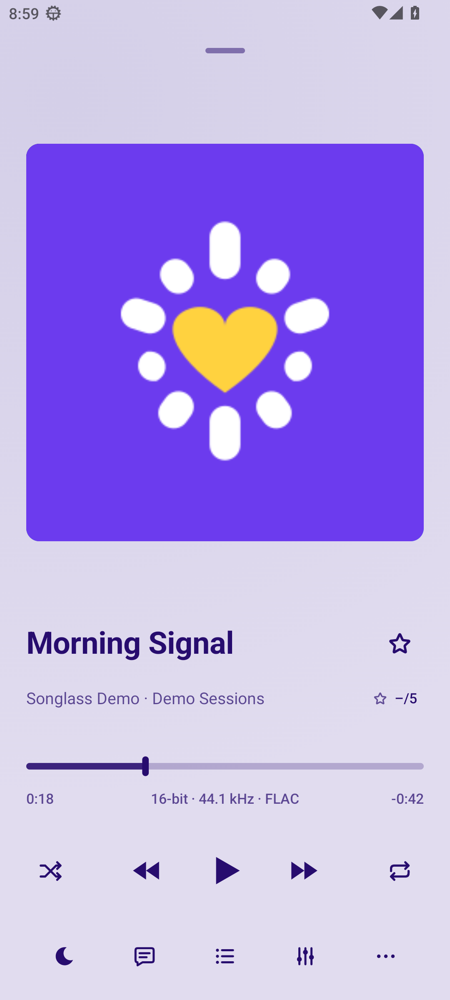
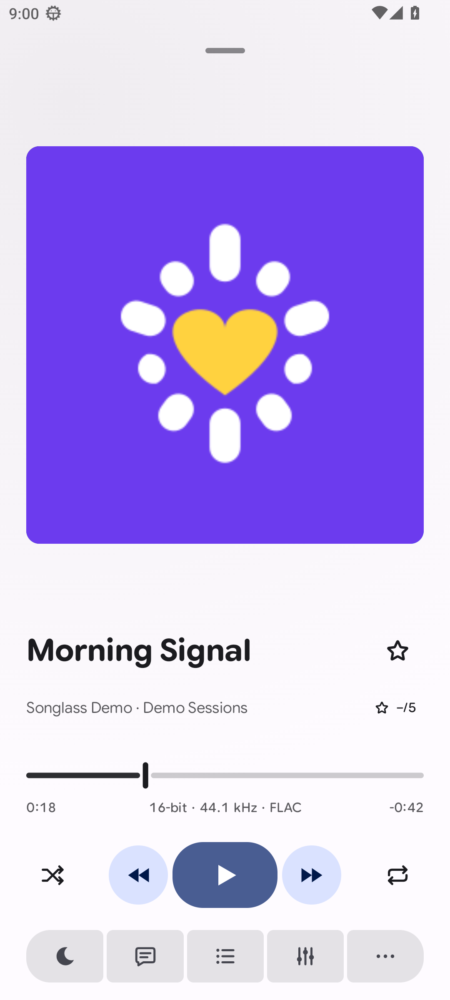
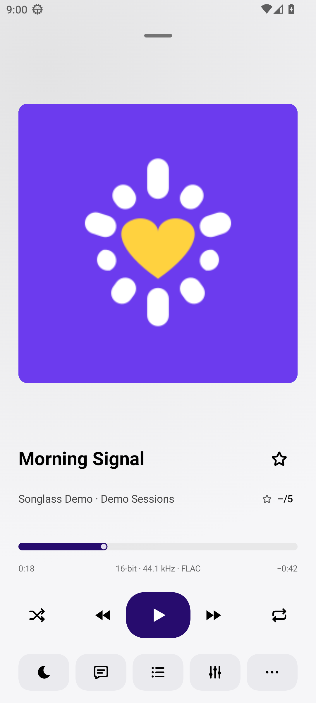
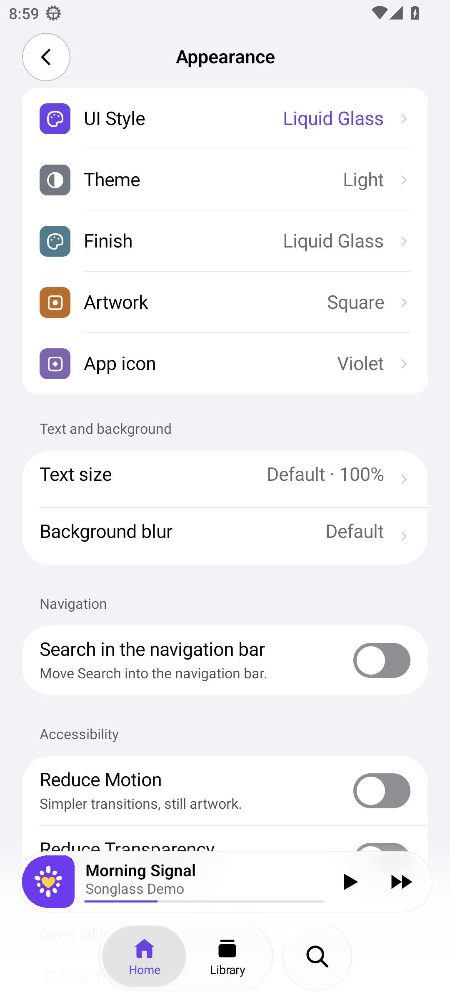
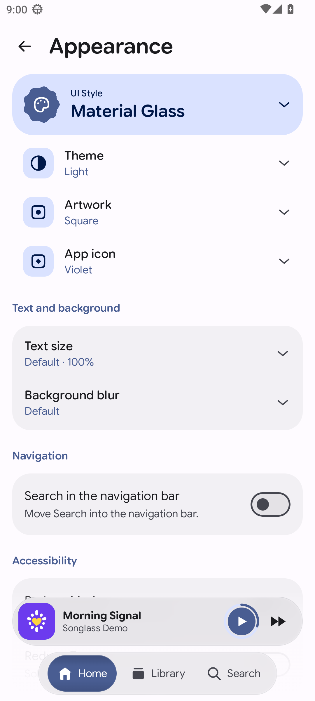
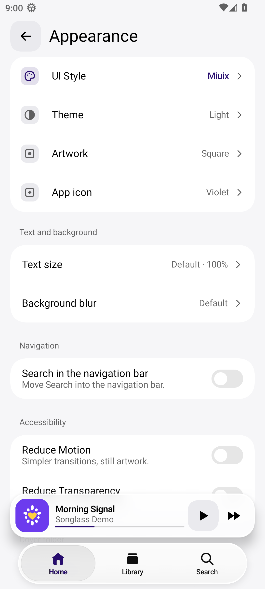

<p align="center">
  
</p>

<h1 align="center">Songlass</h1>

<p align="center"><a href="README.md">English</a> · <strong>Italiano</strong></p>

<p align="center">
  Un lettore musicale locale con tre interfacce distinte.<br>
  Liquid Glass · Material Glass · Miuix
</p>

<p align="center">
  <a href="#schermate">Schermate</a> ·
  <a href="#funzionalità">Funzionalità</a> ·
  <a href="#stato-del-progetto">Piattaforme</a> ·
  <a href="#compilazione-e-controlli">Compilazione</a> ·
  <a href="#contribuire-e-community">Contribuire</a> ·
  <a href="#sostieni-lo-sviluppo">Sostieni</a>
</p>

Songlass riproduce la musica sul tuo dispositivo, con una libreria organizzata, controlli audio configurabili e testi sincronizzati.
Puoi cambiare lo stile dell'intera interfaccia mantenendo la libreria, la sessione di riproduzione e la posizione nell'app.

**In sviluppo per Android 13 e versioni successive.** Il supporto iOS è sperimentale.
[Licenza source-available](LICENSE) · [Roadmap](docs/ROADMAP.md)

**Sito web — WIP:** il sito di presentazione è in [`website/`](website/README.md). È un’anteprima in sviluppo, separata dall’app.

## Schermate

| Liquid Glass | Material Glass | Miuix |
| --- | --- | --- |
| <a href="docs/images/screenshots/liquid-glass-player.png"></a> | <a href="docs/images/screenshots/material-glass-player.png"></a> | <a href="docs/images/screenshots/miuix-player.png"></a> |
| Vetro con rifrazione e barra di navigazione flottante. | Superfici tonali e controlli Material espressivi. | Componenti in stile HyperOS e layout compatti. |

<details>
<summary>Impostazioni Aspetto nei tre stili</summary>

| Liquid Glass | Material Glass | Miuix |
| --- | --- | --- |
| <a href="docs/images/screenshots/liquid-glass-appearance.png"></a> | <a href="docs/images/screenshots/material-glass-appearance.png"></a> | <a href="docs/images/screenshots/miuix-appearance.png"></a> |

</details>

Anteprime della versione Android in sviluppo, con audio dimostrativo sintetico e copertine originali del progetto.
Apri un'immagine per vederla a risoluzione completa. Schermate acquisite su AOSP a 1080×2400, densità 420 e dimensione del testo predefinita.

## Funzionalità

### Libreria e coda

- Esplora brani, album, artisti, generi e cartelle; fissa le raccolte e personalizza la Home.
- Confronta possibili file duplicati per titolo, artista e durata, con percorsi e ascolto; nessuna eliminazione automatica.
- Importa file CUE UTF-8 dalla Libreria per ottenere tracce virtuali dai file audio già indicizzati; gli originali restano disponibili. [Dettagli e limiti](docs/cue-sheets.md).
- Crea playlist, importa ed esporta file M3U e componi playlist intelligenti con regole come la valutazione dei brani.
- Gestisci preferiti, valutazioni a cinque stelle e cronologia, con statistiche e ricordi di ascolto.
- Riordina la coda, aggiungi brani temporanei e salva quelli in arrivo come playlist.
- Ripeti un passaggio con punti A–B temporanei, impostati direttamente nel player.

### Riproduzione e audio

- Riproduzione senza pause tra i brani (gapless), crossfade e dissolvenze configurabili per i comandi di riproduzione.
- ReplayGain, equalizzatore grafico e profili parametrici modificabili con frequenza, guadagno e Q, profili AutoEQ per le cuffie e impostazioni per diverse uscite audio.
- Controlli di bilanciamento, espansione stereo, velocità, bassi, alti e riverbero.
- Ripresa per singolo brano, segnalibri e timer di spegnimento.

### Testi e copertine

- Testi sincronizzati, con evidenziazione parola per parola quando sono disponibili i tempi delle singole parole.
- Importazione dei testi, correzione della sincronizzazione, dimensione di lettura regolabile e schermo acceso durante la lettura.
- Copertine incorporate nei file o presenti nelle cartelle, con ricerca online automatica di quelle mancanti.
- Modifica dei tag dei brani e scelta o sostituzione delle copertine scaricate.

### Aspetto e controlli quotidiani

- Tre stili di interfaccia, aspetto chiaro e scuro e finitura Liquid Metal facoltativa per Liquid Glass.
- Ricerca nelle impostazioni, dimensione del testo, riduzione del movimento e della trasparenza.
- Widget Android, notifiche multimediali, controlli nella schermata di blocco e integrazione Android Auto.
- Comandi delle cuffie configurabili, backup e ripristino e scrobbling Last.fm facoltativo.

## Stato del progetto

| Piattaforma | Stato |
| --- | --- |
| **Android 13 e successivi** | Piattaforma principale di sviluppo. Puoi compilare un APK di debug con le istruzioni qui sotto. |
| **iOS** | Sperimentale. Un IPA iPhone non firmato è disponibile nelle [release](https://github.com/cmdr-chara/Songlass/releases). Richiede una firma prima dell'installazione; le verifiche su dispositivo reale restano aperte. |

Le verifiche di Android Auto, hardware audio, accessibilità e rilascio hanno ancora punti aperti nella
[roadmap](docs/ROADMAP.md). Il comportamento dell'isola multimediale Xiaomi dipende dalle capacità esposte dal dispositivo.

### Rete e privacy

La riproduzione locale non richiede un account né un server musicale. La ricerca di copertine e testi online può
contattare servizi esterni: entrambe sono attive per impostazione predefinita, mentre il recupero delle copertine
è limitato alle connessioni non a consumo. Last.fm è facoltativo e richiede credenziali API proprie.
La [bozza dell'informativa sui dati](docs/PRIVACY.md) descrive servizi, dati e impostazioni coinvolti.

## Compilazione e controlli

Servono **JDK 21 o successivo**, **Android SDK 37** e il wrapper Gradle incluso. Configura il percorso dell'SDK
nel file locale `local.properties` o tramite variabili d'ambiente. Le versioni delle dipendenze sono in
[gradle/libs.versions.toml](gradle/libs.versions.toml).

```bash
./gradlew :androidApp:assembleDebug
```

L'APK di sviluppo viene generato in `androidApp/build/outputs/apk/debug/androidApp-debug.apk`.

GitHub Actions genera anche un APK di debug scaricabile per push e pull request. I tag di versione preparano
release Android firmate **in bozza**. La [guida a build e release Android](docs/android-builds.md) descrive
gli artefatti, la firma e la procedura di rilascio.

Per eseguire i test Android sull'host e lint:

```bash
./gradlew :core:testAndroidHostTest :designsystem:testAndroidHostTest :androidApp:lintDebug
```

Per creare il pacchetto iOS, segui la [guida di compilazione iOS](docs/build-ios-ipa.md).
L'architettura e le regole per i dispositivi sono descritte in [CLAUDE.md](CLAUDE.md).

<details>
<summary>Controlli della documentazione</summary>

Questi controlli richiedono Python 3 e la sua libreria standard:

```bash
python3 tools/check_repository_hygiene.py
python3 -m unittest discover -s tools/tests -p 'test_repository_hygiene.py' -v
```

</details>

<details>
<summary>Struttura della repository</summary>

| Percorso | Responsabilità |
| --- | --- |
| `core` | Logica di libreria, riproduzione, coda, playlist, testi e impostazioni |
| `designsystem` | Contratti UI condivisi e basi del layout |
| `theme-liquidglass`, `theme-materialglass`, `theme-miuix` | Componenti dei tre stili di interfaccia |
| `shared` | Schermate, risorse e collegamento dei componenti dell'app |
| `androidApp`, `iosApp` | Applicazioni native e integrazioni di piattaforma |
| `docs` | Documentazione, schermate, roadmap e guide di compilazione |
| `tools`, `scripts/qa` | Strumenti di compilazione e verifica |

</details>

## Contribuire e community

Sono benvenuti segnalazioni di bug, traduzioni, miglioramenti dell'accessibilità e contributi al codice.
Leggi [CONTRIBUTING.md](CONTRIBUTING.md) prima di inviare il tuo lavoro. La [licenza](LICENSE) consente
esplicitamente fork di lavoro e build di revisione per contribuire a Songlass.

- Dichiara l'eventuale assistenza dell'AI e spiega come hai verificato il risultato.
- Per modifiche al design dell'interfaccia, includi schermate prima/dopo per gli stili coinvolti.
- Rispetta il [Codice di condotta](CODE_OF_CONDUCT.md). Gli agenti di sviluppo devono leggere anche [AGENTS.md](AGENTS.md).

Per domande e richieste di funzionalità, consulta [SUPPORT.md](SUPPORT.md). Per segnalare vulnerabilità, segui [SECURITY.md](SECURITY.md).

## Sostieni lo sviluppo

Le donazioni sono facoltative. Puoi sostenere Songlass usando gli indirizzi qui sotto.
Usa la rete indicata per ciascun indirizzo.

**Bitcoin (BTC) · Rete Bitcoin**

```text
bc1q00duwpvkuc6g6xw590k62pwdha953dxz7rzv0k
```

**Solana (SOL) · Rete Solana**

```text
8PKRGoLVwpbL39FmmMV3V6ps71a2iq4YcaoGsRthMZzi
```

**Litecoin (LTC) · Rete Litecoin**

```text
LSwuNWoHo3wBxzSBZwead2CBxLGLgxEhvu
```

## Licenza

Songlass usa la **[Songlass Source-Available License 1.0](LICENSE)**. È software source-available, non open source secondo la definizione OSI.

Sono consentiti uso e modifiche personali non commerciali, oltre a fork di lavoro, pull request e build di revisione
per contribuire a Songlass, anche tramite lavoro retribuito. Al di fuori di queste attività, la redistribuzione,
la vendita o la pubblicazione di un lettore separato, comprese copie gratuite o rinominate, richiedono un permesso scritto preventivo.

[LICENSING.md](LICENSING.md) chiarisce l'ambito della licenza. I contributori mantengono il copyright;
i componenti di terze parti conservano le proprie licenze e attribuzioni.

## Documentazione

Parti dall'[indice della documentazione](docs/README.md) o dalla [roadmap](docs/ROADMAP.md).
L'[informativa sulla privacy](docs/PRIVACY.md) e la [scheda store](docs/STORE-LISTING.md) sono bozze in sviluppo.
