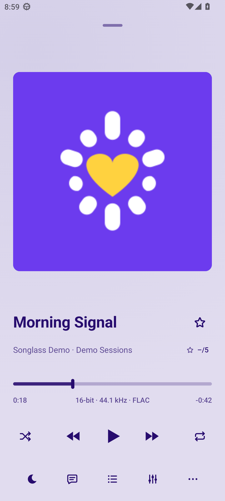
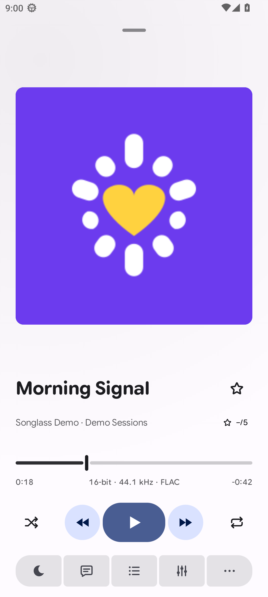
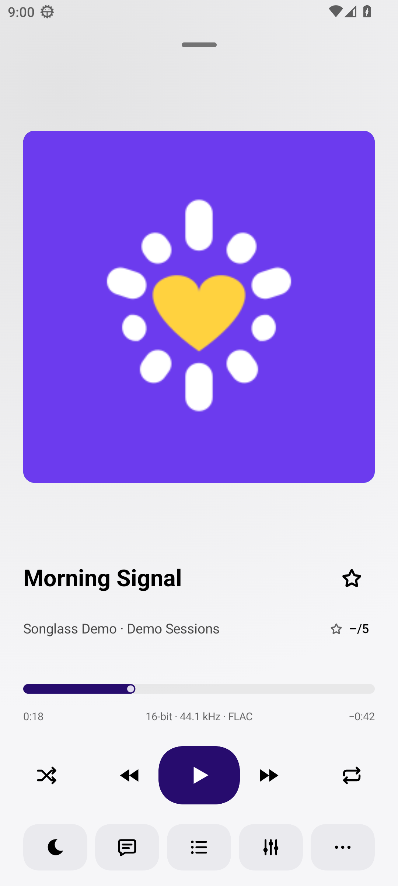
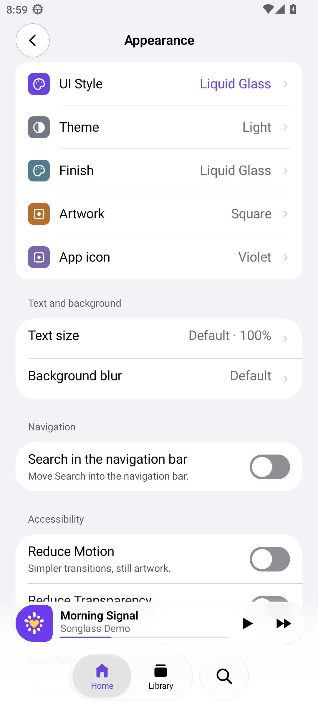
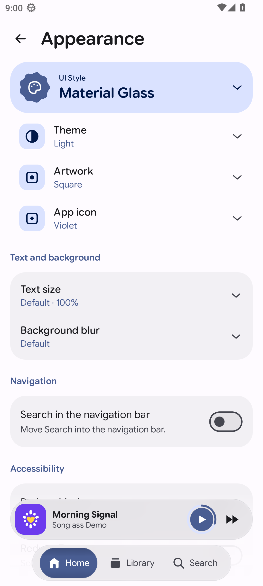
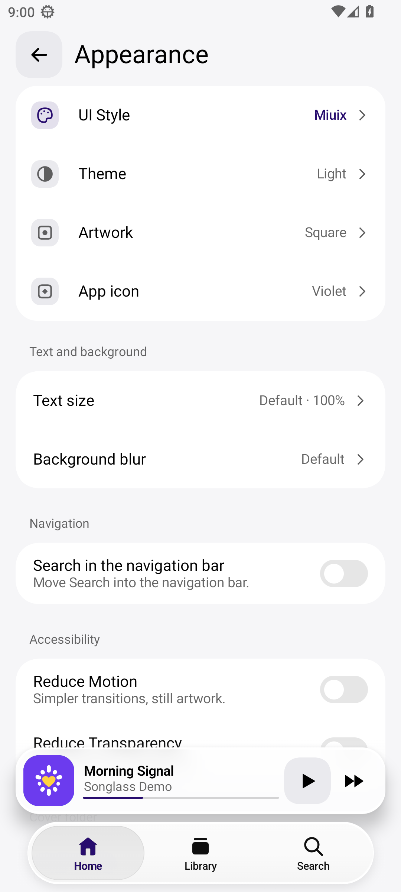

# Songlass

A local music player for Android and iOS, built with Kotlin and Compose Multiplatform.
Choose Liquid Glass, Material Glass or Miuix without changing your library or playback session.

**Source-available:** PolyForm Perimeter 1.0.0 with the Songlass contribution permission.
[License](LICENSE) · [Licensing scope](LICENSING.md) · [Contributing](CONTRIBUTING.md)

## Project status

This is a private development repository. Android playback and device integration are implemented.
iOS has AVFoundation playback, an authorized local Music library source and system Now Playing integration;
Apple builds and device behavior require separate verification. A shared Kotlin compile is not an iPhone test.

Current work and known gaps are tracked in the [roadmap](docs/ROADMAP.md).
Xiaomi integration depends on device capabilities; Apple runtime behavior still requires device verification.

## Screenshots

Native Android screenshots from the AOSP emulator, using synthetic demo audio and project-owned artwork.
The three columns show the same content at 1080×2400, density 420 and default text size; these are not iOS captures.
Open an image for its full resolution.

| Liquid Glass | Material Glass | Miuix |
| --- | --- | --- |
| <a href="docs/images/screenshots/liquid-glass-player.png"></a> | <a href="docs/images/screenshots/material-glass-player.png"></a> | <a href="docs/images/screenshots/miuix-player.png"></a> |
| <a href="docs/images/screenshots/liquid-glass-appearance.png"></a> | <a href="docs/images/screenshots/material-glass-appearance.png"></a> | <a href="docs/images/screenshots/miuix-appearance.png"></a> |

## Build and checks

Use the Gradle wrapper, a compatible JDK and Android SDK. Versions and platform requirements are recorded
in [CLAUDE.md](CLAUDE.md) and [gradle/libs.versions.toml](gradle/libs.versions.toml). Set your SDK location through
local `local.properties` or environment variables; keep machine paths and credentials out of commits.

```bash
./gradlew :androidApp:assembleDebug
./gradlew :core:testAndroidHostTest :designsystem:testAndroidHostTest :androidApp:lintDebug
```

Repository documents, links and bundled license copies can be checked offline with Python 3 (standard library only):

```bash
python3 tools/check_repository_hygiene.py
python3 -m unittest discover -s tools/tests -p 'test_repository_hygiene.py' -v
```

Debug APK: `androidApp/build/outputs/apk/debug/androidApp-debug.apk`.
For local emulator commands, select the intended device explicitly with `adb -s <serial>`.
Follow the existing [device rules](CLAUDE.md) before changing emulator or physical-device configuration.

For iOS packaging, use the [iOS build guide](docs/build-ios-ipa.md) and its Xcode/SDK requirements.

## Repository map

| Path | Responsibility |
| --- | --- |
| `core` | Library, queue, playback domain, settings and other platform-independent logic |
| `designsystem` | Shared UI contracts, tokens and layout foundations |
| `theme-liquidglass`, `theme-materialglass`, `theme-miuix` | Visual primitives for the three interface styles |
| `shared` | Shared screens and application wiring |
| `androidApp`, `iosApp` | Native platform entry points and integrations |
| `docs` | Documentation, roadmap and build guides |
| `tools`, `scripts/qa` | Build helpers and focused validation tools |

## Contributing and community

Bug reports, translations, accessibility improvements, tests, documentation and code contributions are welcome.
Read [CONTRIBUTING.md](CONTRIBUTING.md) before opening an issue or pull request.

- AI assistance is allowed and **must be disclosed**, together with what it helped produce and how the result was checked.
- Pull requests changing UI design must include **before/after screenshots of the actual app**, with comparable context.
- Follow the [Code of Conduct](CODE_OF_CONDUCT.md). For help, see [SUPPORT.md](SUPPORT.md); report vulnerabilities using [SECURITY.md](SECURITY.md).
- Coding agents start with [AGENTS.md](AGENTS.md). Development decisions and verification commands are in [CLAUDE.md](CLAUDE.md).

## License

Original Songlass material uses **PolyForm Perimeter 1.0.0 with the Songlass contribution permission**.
It is source-available software, not open-source software under the OSI definition.

The standard license restricts providing competing products, including competing free or renamed copies.
The additional permission allows working forks, proposed changes, pull requests and review/test builds for the contribution workflow.
The license is not a blanket ban on every commercial use or redistribution.

Read [LICENSE](LICENSE), [LICENSING.md](LICENSING.md) and the [contribution terms](CONTRIBUTING.md#terms-for-submitted-contributions).
Contributors retain their copyright; third-party components retain their own licenses and notices.

## Documentation

Start with the [documentation index](docs/README.md), the [roadmap](docs/ROADMAP.md) and [architecture/work instructions](CLAUDE.md).
The [privacy policy](docs/PRIVACY.md) and [store listing](docs/STORE-LISTING.md) are development drafts, not proof of a published release.
